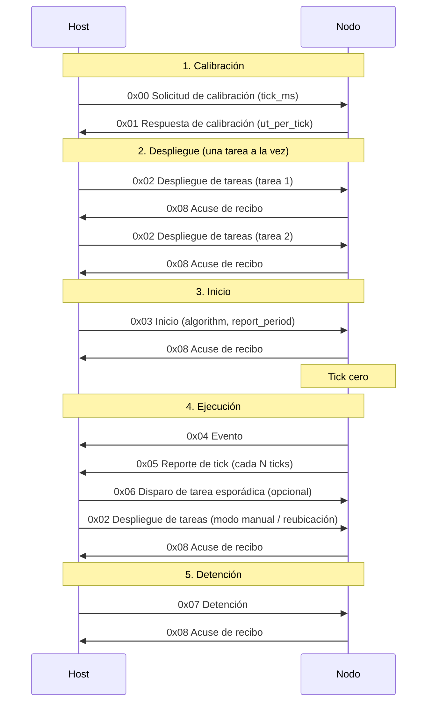

## Protocolo de Comunicación Serial

### Estructura de la trama

| START_MARK |  TYPE  | LOAD_LEN |     LOAD     |   CRC   |
| :--------: | :----: | :------: | :----------: | :-----: |
|   1 byte   | 1 byte |  1 byte  | 0 a 32 bytes | 2 bytes |

- **START_MARK**: siempre `0x7E`. Marca el inicio de una trama.
- **TYPE**: identifica el mensaje (ver tabla de tipos).
- **LOAD_LEN**: cantidad de bytes de `LOAD` (0 a 32).
- **LOAD**: contenido del mensaje.
- **CRC**: CRC-16/CCITT-FALSE (polinomio 0x1021, valor inicial 0xFFFF),
  calculado sobre `TYPE + LOAD_LEN + LOAD`.
- Todos los campos de más de 1 byte se envían en **little-endian** (byte menos significativo primero).

### Tipos de mensaje

| TYPE | Mensaje                     |  Dirección  | Propósito                                                                  |
| :--: | --------------------------- | :---------: | -------------------------------------------------------------------------- |
| 0x00 | Solicitud de calibración    | host → nodo | Informa la duración del tick y pide al nodo medir sus UT por tick          |
| 0x01 | Respuesta de calibración    | nodo → host | El nodo informa sus UT por tick (sₙ)                                       |
| 0x02 | Despliegue de tareas        | host → nodo | Asigna una tarea al nodo (una trama por tarea)                             |
| 0x03 | Inicio                      | host → nodo | Establece el tick cero y configura algoritmo y período del reporte de tick |
| 0x04 | Evento                      | nodo → host | Notifica un suceso en el nodo (liberación, cambio de tarea, plazo perdido) |
| 0x05 | Reporte de tick             | nodo → host | Latido periódico para detectar la caída del nodo                           |
| 0x06 | Disparo de tarea esporádica | host → nodo | Simula la pulsación del botón de la tarea esporádica desde el host         |
| 0x07 | Detención                   | host → nodo | Ordena al nodo detener la ejecución                                        |
| 0x08 | Acuse de recibo             | nodo → host | Confirma que un mensaje del host fue recibido y procesado                  |

### Ejemplo de trama

Solicitud de calibración con tick de 10 ms (`LOAD` = `0A 00`):

    7E | 00 | 02 | 0A 00 | 6B 05

| Campo      | Valor   | Descripción                                    |
| ---------- | ------- | ---------------------------------------------- |
| START_MARK | `7E`    | inicio de trama                                |
| TYPE       | `00`    | solicitud de calibración                       |
| LOAD_LEN   | `02`    | el `LOAD` ocupa 2 bytes                        |
| LOAD       | `0A 00` | `tick_ms = 10` como `uint16` (`little-endian`) |
| CRC        | `6B 05` | CRC = `0x056B` (`little-endian`)               |

### Contenido (LOAD) de cada mensaje

#### 0x00 Solicitud de calibración (2 bytes)

| Campo     | Bytes | Tipo     | Descripción                       |
| --------- | :---: | -------- | --------------------------------- |
| `tick_ms` |   2   | `uint16` | Duración del tick en milisegundos |

#### 0x01 Respuesta de calibración (4 bytes)

| Campo         | Bytes | Tipo     | Descripción                                 |
| ------------- | :---: | -------- | ------------------------------------------- |
| `ut_per_tick` |   4   | `uint32` | UT que el nodo puede ejecutar por tick (sₙ) |

El host debe rechazar un valor igual a 0, porque `C = ⌈W / sₙ⌉` dividiría entre cero.

#### 0x02 Despliegue de tareas (8 bytes)

| Campo        | Bytes | Tipo     | Descripción                             |
| ------------ | :---: | -------- | --------------------------------------- |
| `task_id`    |   1   | `uint8`  | Identificador de la tarea               |
| `kind`       |   1   | `uint8`  | 0 = periódica, 1 = esporádica           |
| `cost_ticks` |   2   | `uint16` | C(i, n) en ticks, calculado por el host |
| `period`     |   2   | `uint16` | T en ticks                              |
| `deadline`   |   2   | `uint16` | D relativo en ticks                     |

#### 0x03 Inicio (3 bytes)

| Campo           | Bytes | Tipo     | Descripción                                    |
| --------------- | :---: | -------- | ---------------------------------------------- |
| `algorithm`     |   1   | `uint8`  | 0 = RMS, 1 = EDF                               |
| `report_period` |   2   | `uint16` | Cada cuántos ticks se envía el reporte de tick |

#### 0x04 Evento (8 bytes)

| Campo        | Bytes | Tipo     | Descripción                                          |
| ------------ | :---: | -------- | ---------------------------------------------------- |
| `tick`       |   4   | `uint32` | Ticks transcurridos desde el mensaje de inicio       |
| `event_type` |   1   | `uint8`  | Tipo de evento (ver tabla)                           |
| `task_id`    |   1   | `uint8`  | Tarea involucrada (`0xFF` = ninguna / nodo inactivo) |
| `aux`        |   2   | `uint16` | Dato extra según el evento                           |

| `event_type` | Significado                                             | `aux`                        |
| :----------: | ------------------------------------------------------- | ---------------------------- |
|      0       | Liberación de un trabajo                                | no se usa                    |
|      1       | Cambio de tarea (`task_id` = la que pasa a ejecutar)    | no se usa                    |
|      2       | Trabajo completado                                      | tiempo de respuesta en ticks |
|      3       | Plazo perdido (el trabajo se aborta)                    | no se usa                    |
|      4       | Evento esporádico ignorado (antes del intervalo mínimo) | no se usa                    |

#### 0x05 Reporte de tick (6 bytes)

| Campo        | Bytes | Tipo     | Descripción                                |
| ------------ | :---: | -------- | ------------------------------------------ |
| `tick`       |   4   | `uint32` | Tick actual del nodo                       |
| `bad_frames` |   2   | `uint16` | Tramas descartadas por el nodo hasta ahora |

#### 0x06 Disparo de tarea esporádica (1 byte)

| Campo     | Bytes | Tipo    | Descripción                     |
| --------- | :---: | ------- | ------------------------------- |
| `task_id` |   1   | `uint8` | Tarea esporádica que se dispara |

#### 0x07 Detención (0 bytes)

Sin `LOAD` (`LOAD_LEN = 0`). La trama queda: `7E | 07 | 00 | CRC CRC`.

#### 0x08 Acuse de recibo (2 bytes)

| Campo        | Bytes | Tipo    | Descripción                                  |
| ------------ | :---: | ------- | -------------------------------------------- |
| `acked_type` |   1   | `uint8` | `TYPE` del mensaje que se confirma           |
| `status`     |   1   | `uint8` | 0 = OK, 1 = datos inválidos, 2 = sin espacio |

### Cálculo del CRC

El CRC se calcula sobre los bytes `TYPE`, `LOAD_LEN` y `LOAD`, procesados uno tras otro en ese orden. En el ejemplo
son 4 bytes: `00 02 0A 00`.

Algoritmo (CRC-16/CCITT-FALSE):

```c
uint16_t crc = 0xFFFF;                    // valor inicial
for (cada byte b de TYPE, LOAD_LEN, LOAD) {
    crc ^= (uint16_t)b << 8;              // mete el byte en la parte alta
    for (int i = 0; i < 8; i++) {         // 8 bits por byte
        if (crc & 0x8000)                 // bit de la izquierda = 1
            crc = (crc << 1) ^ 0x1021;    //   desplaza y aplica el polinomio
        else                              // bit de la izquierda = 0
            crc = crc << 1;               //   solo desplaza
    }
}
```

### Flujo de la conversación

La comunicación tiene cinco fases, siempre en este orden:



#### Qué mensajes llevan acuse de recibo

| Mensaje                       | ¿Lleva ACK? | Cómo sabe el emisor que llegó                              |
| ----------------------------- | :---------: | ---------------------------------------------------------- |
| 0x00 Solicitud de calibración |     No      | La respuesta de calibración (0x01) es la confirmación      |
| 0x02 Despliegue de tareas     |   **Sí**    | El nodo responde ACK con el estado                         |
| 0x03 Inicio                   |   **Sí**    | El nodo responde ACK al fijar el tick cero                 |
| 0x04 Evento                   |     No      | Alto volumen; se acepta la pérdida de una trama corrupta   |
| 0x05 Reporte de tick          |     No      | La falta de N reportes consecutivos declara al nodo caído  |
| 0x06 Disparo esporádica       |     No      | El evento de liberación (o de evento ignorado) lo confirma |
| 0x07 Detención                |   **Sí**    | El nodo responde ACK antes de detenerse                    |

El ACK siempre va de nodo a host. El host nunca confirma los mensajes del nodo.

#### Valores de `status` del ACK

| Mensaje confirmado | `status` = 0 (OK)  | `status` = 1 (datos inválidos)                                               | `status` = 2 (sin espacio) |
| ------------------ | ------------------ | ---------------------------------------------------------------------------- | -------------------------- |
| Despliegue (0x02)  | Tarea registrada   | `cost_ticks` o `period` en 0, `kind` desconocido, o segunda tarea esporádica | El nodo ya tiene 8 tareas  |
| Inicio (0x03)      | Ejecución iniciada | `algorithm` desconocido                                                      | no aplica                  |
| Detención (0x07)   | Nodo detenido      | no aplica                                                                    | no aplica                  |

#### Reglas de la conversación

- **Un despliegue a la vez** (stop-and-wait): el host envía una tarea y espera
  su ACK antes de enviar la siguiente. Así el ACK corresponde sin ambigüedad
  a la última tarea enviada.
- **Timeout y reintentos**: si el ACK no llega en 500 ms, el host reenvía el
  mensaje. En la solicitud de calibración (0x00) el host espera la respuesta
  0x01 con un timeout propio, mayor, porque el nodo debe ejecutar la medición.
  Tras 3 reintentos fallidos, el nodo se considera no disponible. Los
  timeouts son configurables.
- **Mensajes idempotentes**: como el host puede reenviar un mensaje cuyo ACK se
  perdió, el nodo debe tolerarlo:
  - Un `0x02` con un `task_id` ya registrado no crea una tarea duplicada; el
    nodo responde ACK (OK).
  - Un `0x03` recibido con el sistema ya iniciado no reinicia el tick cero;
    el nodo responde ACK (OK).
  - Un `0x07` recibido con el nodo ya detenido responde ACK (OK).
- **Tick cero**: el nodo lo fija al procesar el mensaje de inicio. El desfase
  entre nodos depende del instante en que cada uno recibe su `0x03`.
- **Host desconectado**: el nodo sigue ejecutando sus tareas. Solo un mensaje
  de detención (0x07) las detiene.
- **Modo manual y reubicación**: agregar una tarea con el sistema en marcha usa
  el mismo mensaje `0x02` con su ACK, sin detener la ejecución.

#### Mensajes válidos según el estado del nodo

| Estado del nodo         | Mensajes que acepta    |
| ----------------------- | ---------------------- |
| Sin calibrar            | 0x00, 0x07             |
| Calibrado (desplegando) | 0x00, 0x02, 0x03, 0x07 |
| En ejecución            | 0x02, 0x06, 0x07       |
| Detenido                | 0x07                   |

### Recepción y validación

El receptor procesa los bytes de uno en uno y valida en dos niveles.

**Nivel de trama** (¿llegó bien?):

1. Descarta bytes hasta encontrar `0x7E`.
2. Lee `TYPE` y `LOAD_LEN`. Si `LOAD_LEN` > 32, descarta la trama.
3. Lee `LOAD_LEN` bytes de `LOAD` y 2 bytes de CRC, y reconstruye el valor
   recibido.
4. Calcula el CRC sobre `TYPE + LOAD_LEN + LOAD` con el mismo algoritmo y lo
   compara. Si no coincide, descarta la trama.
5. Toda trama descartada se contabiliza como corrupta, y el receptor vuelve al
   paso 1 para resincronizarse con el siguiente `0x7E`.

**Nivel de mensaje** (¿tiene sentido?): una trama con CRC válido se ignora y se
contabiliza si:

- su `TYPE` es desconocido,
- su `LOAD_LEN` no coincide con el tamaño definido para ese `TYPE`
- llega en una fase de la conversación que no le corresponde.

Si el mensaje es de un tipo que lleva ACK, el nodo responde con `status` = 1.

### Configuración del puerto serial

| Parámetro        | Valor                         |
| ---------------- | ----------------------------- |
| Velocidad        | 115200 baudios (configurable) |
| Bits de datos    | 8                             |
| Paridad          | Ninguna                       |
| Bits de parada   | 1                             |
| Control de flujo | Ninguno                       |

Host y nodos deben usar la misma configuración. La velocidad se define en el
archivo de configuración; los demás parámetros son fijos.
